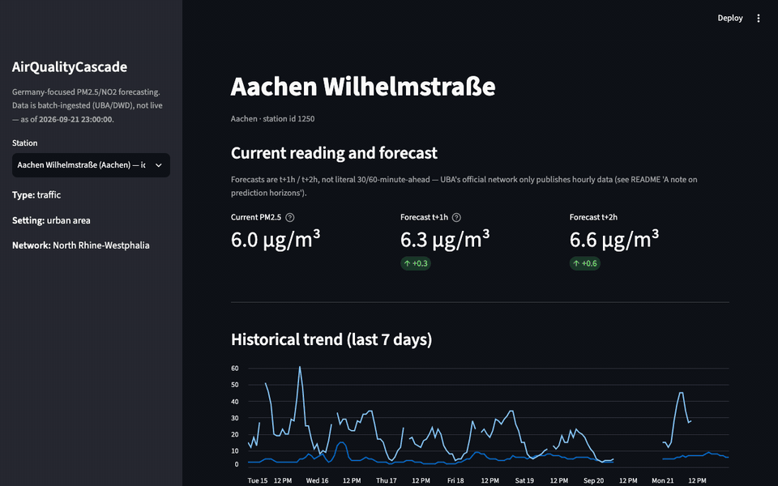
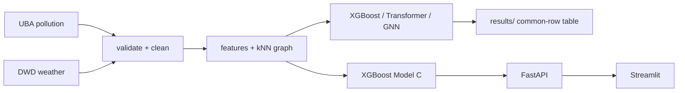

# AirQualityCascade

Hourly PM2.5 and NO2 forecasts (t+1h, t+2h) for 315 German monitoring stations from open UBA pollution and DWD weather data. It asks whether neighbouring-station information improves short-term forecasts, compares XGBoost, a Transformer and a GNN on identical test rows, and serves one model through an API and dashboard.

[](https://github.com/nithya-prakash/AirQualityCascade/actions/workflows/ci.yml)  



*Recorded from the running local dashboard: forecast, the model comparison, the station map and the hardest station's spike history. Does not show a hosted deployment or a live data feed.*

## Results

| Metric | Result | Data | Reproduce |
|---|---|---|---|
| PM2.5 t+1h R², best model | Transformer 0.604; XGBoost (served) 0.588; persistence 0.452 | 83,970 common test rows, 315 stations, 13.5 days | `python scripts/evaluate_common_rows.py` |
| PM2.5 t+2h R², best model | XGBoost 0.480; GNN 0.451; Transformer 0.443; persistence 0.210 | same rows | same |
| Neighbour features, XGBoost tier B to C | R² 0.555 to 0.592 (t+1h), 0.428 to 0.473 (t+2h) | same rows; tiers retrained | same |
| Neighbour mean vs GNN | XGBoost tier C 0.592 vs GNN 0.584 (t+1h), 0.473 vs 0.451 (t+2h) | same rows | same |
| Spike detection, Model C t+1h | precision 0.72, recall 0.47 | 1,295 spike hours (train 90th percentile, 13 µg/m³) | `python scripts/error_analysis.py` |
| Tests | ruff and mypy clean; 88 passed, 14 skipped without data; 102 passed with it | 86 source files | `pytest` (GitHub Actions: 88 passed, 14 skipped) |

**Honest reading:** one 13.5-day summer test window, one run per model, no confidence intervals, so gaps under about 0.01 R² are noise (retrained tiers moved by up to 0.008). Neighbour features help XGBoost clearly, but the Transformer, which sees none, is best at t+1h, so spatial information is not shown to be necessary. An earlier table compared models on different rows; the numbers above replace it. Never run: a live feed, a hosted deployment, multiple seeds.

## Quickstart

```bash
uv venv --python 3.12 && source .venv/bin/activate && uv pip install -e ".[dev]" -c constraints.txt
python scripts/ingest.py && python scripts/preprocess.py && python scripts/build_features.py && python scripts/train_baselines.py
uvicorn aqcascade.api.main:app --port 8010 --app-dir src & PYTHONPATH=src streamlit run app/streamlit/dashboard.py --server.port 8512
```

Data and models are not in the repository, so the first run builds them (about 5 min ingest, 7 to 14 min training). On macOS run `brew install libomp` first.

| Variable | Purpose |
|---|---|
| `AQCASCADE_API_URL` | where the dashboard finds the API (default `http://localhost:8010`) |
| none required | UBA and DWD need no API key; `.env.example` lists optional overrides |

## Architecture



Python 3.12, pandas, XGBoost, PyTorch and PyG, MLflow, Prefect, FastAPI, Streamlit, Docker. Only Model C is served.

## Usage

```bash
curl -X POST localhost:8010/predict -H "Content-Type: application/json" \
  -d '{"station_id": 21, "pollutant": "pm25", "horizon_hours": 1}'   # 5.9 µg/m³ for the last ingested hour
docker run --rm -v "$PWD:/app" -w /app aqcascade-eval python scripts/evaluate_common_rows.py   # build first: docker build -t aqcascade-eval -f docker/Dockerfile.eval .
docker compose up -d     # API on :8013, dashboard on :8512 (needs data/ and models/)
```

## Limitations

- Forecasts are t+1h and t+2h from batch-ingested data, not a live feed or literal 30/60 minutes (UBA publishes hourly).
- 90 days of summer data, 315 stations; one chronological split; no confidence intervals, multiple seeds or rolling-origin validation.
- The GNN is a deliberately simple 2-layer GraphSAGE; spike recall (0.47) is weak; NO2 is XGBoost only.
- Ablation tiers were retrained for the comparison (their models were not saved) and are not exactly reproducible.
- Models are joblib pickles, tied to XGBoost 3.4.1 (pinned); a portable format is not implemented.
- `data/`, `models/` and `mlruns/` are not committed, so `results/` is the only record of the numbers until the pipeline is re-run.
- `uncertainty` in `/predict` is a historical test residual, not a per-prediction interval.

## More

Layout: `src/aqcascade/` (package), `scripts/` (pipeline and evaluation), `app/streamlit/`, `tests/`, `docker/`, `results/`. Checks: `ruff check . && mypy src scripts tests && pytest`. Full method, spatial experiment, error analysis, feature status and roadmap: [docs/details.md](docs/details.md). License: MIT. UBA and DWD data keep their own licenses (listed in details).
