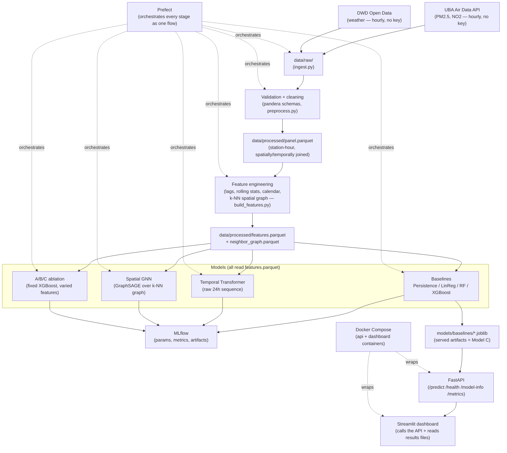

# AirQualityCascade

Germany-focused short-term air-quality forecasting: PM2.5/NO2 forecasts at
**t+1h and t+2h** from UBA (pollution) and DWD (weather) open hourly data.

**Research question:** does spatial information from neighboring stations
improve short-term forecasting over a station's own history and weather
alone?

**Answer** ([Spatial experiment](#spatial-experiment)): within an XGBoost ablation, yes — adding
neighbour features gives +0.037 (t+1h) and +0.045 (t+2h) R² over local history plus weather, and a
simple neighbour mean beats a 2-layer GraphSAGE GNN learning the aggregation itself. That is a finding
about this model family, dataset and 90-day window: a Transformer with no neighbour features scores
highest at t+1h, so spatial information is not shown to be *necessary*.

[](https://github.com/nithya-prakash/AirQualityCascade/actions/workflows/ci.yml)  


*Recorded from the running dashboard (API + Streamlit, local, batch-ingested data): forecast for a
station, the model comparison on the common rows, and the map. Does not show a hosted
deployment or a live data feed.*

## Results

PM2.5 forecasts, every model scored on the same 83,970 test rows (protocol under *Evaluation method*). Newly measured on 2026-10-14; the two full runs gave identical numbers. One chronological test window, one run per model, no confidence intervals.

### Model comparison (83,970 common rows)

| Model | t+1h MAE | t+1h RMSE | t+1h R² | t+2h MAE | t+2h RMSE | t+2h R² |
|---|--:|--:|--:|--:|--:|--:|
| Persistence | **0.725** | 2.139 | 0.452 | 1.106 | 2.556 | 0.210 |
| Linear regression | 0.800 | 1.902 | 0.567 | 1.125 | 2.212 | 0.408 |
| Random forest | 0.770 | 1.990 | 0.526 | 1.082 | 2.152 | 0.440 |
| XGBoost (Model C, the served model) | 0.742 | 1.855 | 0.588 | **1.037** | **2.074** | **0.480** |
| GNN | 0.869 | 1.864 | 0.584 | 1.117 | 2.130 | 0.451 |
| Transformer (no neighbour features) | 0.830 | **1.818** | **0.604** | 1.137 | 2.147 | 0.443 |

- **t+1h:** the Transformer still has the highest R² and lowest RMSE, but its lead over XGBoost shrank
  from 0.030 R² (0.618 vs 0.588 as first reported) to 0.016 once both are scored on the same rows. It has
  a *worse* MAE than persistence and XGBoost. There is one model run per method and no confidence interval,
  so I do not claim the 0.016 gap is significant.
- **t+2h:** XGBoost is best on every metric; the Transformer is below XGBoost, the GNN and random forest on R².
- Persistence has the lowest MAE at t+1h (most hours barely change) but a low R² (it cannot see sharp
  swings coming): different metrics, not a contradiction. NO2 t+1h was only trained as XGBoost (R² 0.846 on its
  own rows) and is not part of this comparison.

### Spatial experiment

Holds architecture fixed (XGBoost) and varies only feature access, in strictly nested tiers
([`feature_groups.py`](src/aqcascade/models/feature_groups.py)), plus the GNN trained on Model B's exact
feature scope. Scored on the same 83,970 common rows as above; tiers A/B/C are retrained, the GNN is the
saved checkpoint:

| Model | Features | t+1h R² | t+2h R² |
|---|--:|--:|--:|
| A — local history only | 54 | 0.548 | 0.421 |
| B — A + weather | 63 | 0.555 | 0.428 |
| D — B + GNN message passing | 66 | 0.584 | 0.451 |
| **C — B + neighbour features** | 69 | **0.592** | **0.473** |

The ranking A < B < D < C holds at both horizons. What the numbers support:

- **Spatial context helps XGBoost.** B → C adds +0.037 (t+1h) and +0.045 (t+2h) R², much larger than the
  ≈0.008 retraining noise seen above.
- **Weather adds little.** A → B is +0.007 at both horizons, about the size of that noise, so I do not
  claim weather helps.
- **Neighbour mean vs GNN:** C beats the GNN by 0.008 at t+1h (within noise, inconclusive) and 0.022 at
  t+2h (clearer). The GNN is a deliberately simple 2-layer GraphSAGE on 90 days of data.
- **This does not show spatial information is necessary.** The Transformer, which sees no neighbour
  features, scores above every XGBoost tier at t+1h (0.604) and below them at t+2h (0.443). The claim is
  restricted to the XGBoost ablation.

These are single runs on one 13.5-day summer test window. No multiple seeds, confidence intervals or
rolling-origin validation were run.

### Error analysis

Model C (t+1h), scored on the same 83,970 common rows as the comparison above. Traffic stations are
harder to forecast than background stations (mean MAE 0.803 vs 0.721) — burstier, less
autocorrelated PM2.5. Per-station MAE correlates with that station's own outlier rate (r = 0.655).
Spike classification (train-period 90th-percentile threshold): precision 0.72, recall 0.47 —
conservative, usually right when it flags a spike but misses over half of real ones. Full breakdown:
`data/processed/error_analysis_*.csv` (regenerated 2026-10-14 on the common rows; the earlier
all-target-present rows gave 0.807 vs 0.722, r = 0.657, precision 0.71, recall 0.47).

## Quickstart

The repository does not contain the data or trained models (`data/` and `models/` are gitignored), so the
first run builds them. Python 3.12; on macOS `brew install libomp` first (XGBoost needs OpenMP).

```bash
uv venv --python 3.12 && source .venv/bin/activate
uv pip install -e ".[dev]" -c constraints.txt     # exact versions the results came from
python scripts/ingest.py && python scripts/preprocess.py && python scripts/build_features.py
python scripts/train_baselines.py                  # ~7-14 min; writes the served XGBoost model
uvicorn aqcascade.api.main:app --port 8010 --app-dir src &
PYTHONPATH=src streamlit run app/streamlit/dashboard.py --server.port 8512
```

Training the Transformer, GNN and ablation, the Prefect flow, MLflow, Docker and the common-row evaluation are in
*Full pipeline* below.

### Full pipeline

```bash
# Environment (Python 3.12)
uv venv --python 3.12 && source .venv/bin/activate && uv pip install -e ".[dev]"

python scripts/ingest.py               # writes data/raw/, no API key needed (~5 min)
python scripts/preprocess.py           # validate + clean + join
python scripts/build_features.py       # leakage-safe feature table
python scripts/train_baselines.py      # ~7-14 min
python scripts/train_transformer.py    # ~3 min on Apple Silicon MPS
python scripts/train_gnn.py            # ~1 min on Apple Silicon MPS
python scripts/run_ablation.py         # ~40s
python scripts/error_analysis.py       # ~10s

# Fair model comparison on one common set of test rows (needs the trained models above;
# pinned CPU environment in docker/Dockerfile.eval, see "Evaluation method"):
docker build -t aqcascade-eval -f docker/Dockerfile.eval .
docker run --rm -v "$PWD:/app" -w /app aqcascade-eval python scripts/evaluate_common_rows.py

# --- or run everything after ingestion as one Prefect flow: ---
python -c "from aqcascade.pipeline.flows import full_pipeline; full_pipeline(skip_ingestion=True)"

mlflow ui --backend-store-uri sqlite:///mlruns/mlflow.db   # inspect tracked runs

# Serve directly, or containerized:
uvicorn aqcascade.api.main:app --port 8010 --app-dir src &
PYTHONPATH=src streamlit run app/streamlit/dashboard.py --server.port 8512
docker compose up -d   # api on :8013, dashboard on :8512
```

**macOS**: XGBoost needs the OpenMP runtime — `brew install libomp` before
training, or `pip install xgboost` raises `dlopen ... libomp.dylib` on import.

## How it works

### Data

| Source | What | Resolution | License |
|---|---|---|---|
| [UBA Air Data API v3](https://www.umweltbundesamt.de/api/air_data/v3) | PM2.5, NO2 and other pollutants at German stations | **Hourly** (verified live — no sub-hourly values exist) | Datenlizenz Deutschland – Namensnennung 2.0 |
| [DWD Open Data (CDC)](https://opendata.dwd.de/climate_environment/CDC/observations_germany/climate/) | Temperature, wind, pressure, precipitation, humidity | Hourly | CC BY 4.0 |

No API key required for either. Full field docs:
[`configs/data_sources.yaml`](configs/data_sources.yaml).

**On prediction horizons**: the original brief targeted 30-/60-minute
forecasts. UBA's network only publishes hourly aggregates (confirmed by
querying live data — no finer granularity exists), so interpolating to
synthesize 30-minute points would misrepresent the data. This project
forecasts **t+1h / t+2h** instead — the finest horizon the real data
actually supports.

**Scale** (90-day window, 2026-06-24 → 2026-09-21): 315 PM2.5 stations,
664,791 hourly observations (97.7% of theoretical max), 251/315 stations
have a same-pollutant neighbor within 25km. Full stats:
`data/raw/manifest.json`, reproducible via
[`scripts/ingest.py`](scripts/ingest.py).

Every raw table is [pandera](https://pandera.readthedocs.io/)-validated for
physical plausibility before cleaning
([`schemas.py`](src/aqcascade/validation/schemas.py)) — caught a real bug
where DWD's raw station-level pressure column was mapped instead of
sea-level pressure, producing impossible ~700 hPa readings at high-elevation
stations. Missing values are never silently filled; every `NaN` is carried
forward for feature engineering to handle explicitly.

### Architecture



Only the baseline XGBoost model ("Model C") is served via the API — the
Transformer and GNN exist to answer the research question, not for
production serving, since a single-station prediction request doesn't have
the other 314 stations' simultaneous data a GNN snapshot needs.

### Methodology

**Leakage prevention**: for a prediction at time T, only data at-or-before T
is used; splits are strictly chronological, never random. Guards live in
[`validation/leakage.py`](src/aqcascade/validation/leakage.py) and gate every
split via [`evaluation/split.py`](src/aqcascade/evaluation/split.py).
[`test_feature_leakage.py`](tests/data/test_feature_leakage.py) runs the real
feature-building code on a synthetic panel with a spike planted at a future
hour and asserts no feature sees it early (with a positive control proving
the check isn't vacuous).

**Features** (69 feature columns, 72 model inputs after one-hot encoding `season`; 680,400 rows = 315 stations × 2,160 hours,
[`features.yaml`](configs/features.yaml)): pollution history (lags, rolling
stats, rate-of-change), weather, calendar (cyclically encoded), and spatial
(k=5 nearest same-pollutant neighbors within 100km).

**Models**: Persistence / Linear Regression / Random Forest / XGBoost
baselines; a Temporal Transformer learning directly from a raw 24h sequence
(no neighbor features, no hand-engineered lags); and a Spatial GNN
(2-layer GraphSAGE over the same k-NN graph) that learns spatial aggregation
instead of consuming a pre-computed neighbor summary.

### MLOps

**MLflow** — every training script logs params, metrics, a content hash of
the exact feature file used (`dataset_version`), and (for baselines,
Transformer, GNN — not the 6 ablation runs, which compare feature tiers
only) the trained artifact. Verified: **20 runs across 4 experiments**
actually logged. `mlflow ui --backend-store-uri sqlite:///mlruns/mlflow.db`.

**Prefect** — [`pipeline/flows.py`](src/aqcascade/pipeline/flows.py) wraps
the existing scripts as tasks in one flow, each shelling out to the real
script rather than reimplementing it, no server required. Verified with a
real, complete ~27-minute end-to-end run, all tasks `Completed` — the
results throughout this README come from that run.

**Docker** — the image serves the API and dashboard from already-trained
artifacts (never trains) with a trimmed dependency set (no torch/mlflow/
prefect at runtime). Built and run for real: `/health` and `/predict`
verified via `curl` through the container, dashboard verified in-browser
through the container network, matching the non-Docker run exactly. Image
is 1.92GB — larger than ideal, because a version-mismatch bug (a joblib-
pickled XGBoost model loaded under a different XGBoost major version
silently produced a different prediction) means the serving image must
match the training XGBoost version rather than use a slimmer pin.
`docker compose up -d && curl http://localhost:8013/health`.

**CI** — [`ci.yml`](.github/workflows/ci.yml) runs `ruff`, `mypy`, `pytest` on push/PR; it doesn't
retrain or hit live APIs. Tests needing real trained models `skipif` on their absence
([`conftest.py`](tests/conftest.py)). The latest GitHub Actions run (2026-09-25, 4 of 4 runs succeeded)
reported `ruff` clean, `mypy` clean on 81 files and `78 passed, 13 skipped`; the skips are the tests that
need the local data and models. That run predates the common-row evaluation and the version pins. `ci.yml` now installs
with `-c constraints.txt`. Checked locally in a clean `python:3.12-slim` Linux container (arm64, not the x86_64
GitHub runner, so not proof of Actions compatibility): the install succeeded, `ruff` and `mypy` (86 files) were
clean, and `pytest` gave 88 passed / 14 skipped without the data and models (the skips are the tests that need
them) and 102 passed / 0 skipped with them. `ruff` needed `known-first-party` set in `pyproject.toml`: without it
ruff 0.16.8 flagged import order in 13 files on Linux. It has not run on GitHub Actions.

## Usage

### API

FastAPI service ([`src/aqcascade/api/`](src/aqcascade/api/)) serving the
same XGBoost "Model C" artifact evaluated above — verified byte-for-byte
identical in feature composition to the ablation's Model C. Serves from
batch-ingested data, never a live feed; every response carries
`as_of_timestamp`.

```bash
uvicorn aqcascade.api.main:app --port 8010 --app-dir src
curl -X POST http://localhost:8010/predict -H "Content-Type: application/json" \
  -d '{"station_id": 21, "pollutant": "pm25", "horizon_hours": 1}'
# -> {"predicted_value": 5.9, "model_version": "xgboost-model-c__target_pm25_h1",
#     "uncertainty": {"mae": 0.75, "rmse": 1.846, "r2": 0.588}}
```

Unknown `station_id` → `404`; an untrained (pollutant, horizon) combination
→ `422`; malformed requests are rejected by Pydantic before reaching the
model. Also `GET /health`, `/model-info`, `/metrics`, docs at `/docs`.
Tested end-to-end in [`tests/api/test_api.py`](tests/api/test_api.py).

### Dashboard

```bash
uvicorn aqcascade.api.main:app --port 8010 --app-dir src &
PYTHONPATH=src streamlit run app/streamlit/dashboard.py --server.port 8512
```

[`dashboard.py`](app/streamlit/dashboard.py) calls the live API for
forecasts and reads every other number from this project's own output
files: current reading + forecast with a spike alert, 7-day trend,
neighboring-station values, model comparison, per-station error stats, and
a pydeck map — see the GIF above.

## Evaluation method

Every model uses the same chronological split (first 70% of hours train, next 15% validation, last 15%
test; test = 2026-09-08 12:00 → 2026-09-21 23:00, 324 hours, 315 stations, 102,060 station-hours).
The tables in Results score **every model on the same 83,970 test rows**: rows where both PM2.5 targets
(t+1h and t+2h) and the current PM2.5 value are present (`select_common_rows` in
[`common_rows.py`](src/aqcascade/evaluation/common_rows.py)). The current value is required because
persistence copies it. All models are scored against identical target values with the same metric
function, and a model that cannot predict a common row is an error, not a silent drop.

This replaced an earlier table that compared models on different rows (n = 84,934 for the baselines,
85,595 for the ablation and GNN, 93,619 for the Transformer). The Transformer's split is computed on
its valid samples only, so its test window started 29 hours earlier (2026-09-07 07:00) and 8,994 of its
93,619 rows fell before the shared test window. Re-scoring: [`evaluate_common_rows.py`](scripts/evaluate_common_rows.py),
output in [`results/`](results/). Saved models and the Transformer/GNN checkpoints are re-used; the
ablation tiers were not saved and are **retrained** by the same procedure.

Before trusting the regenerated predictions, each model was re-scored on its own original rows: the saved
models, Transformer and GNN reproduce their previously reported R² to within 1e-7
([`common_rows_gate.csv`](results/common_rows_gate.csv)); the retrained ablation tiers differ from the
originals by up to 0.008 R² (different platform, same code and seed). Those ablation runs are therefore
*not* exactly reproducible, and 0.008 is the size of retraining noise to keep in mind when reading small gaps.
The common-row numbers below were newly measured on 2026-10-14 and were identical across two full runs
(deterministic given the saved models and a fixed seed); that is not multi-seed validation.

## Feature status

| Component | Status | Notes |
|---|---|---|
| Ingestion (UBA + DWD, hourly) | Implemented | 90-day window, 315 stations, no API key |
| Validation and leakage guards | Implemented | pandera schemas, chronological splits, planted-spike test |
| Feature engineering | Implemented | 69 feature columns (72 inputs after one-hot encoding `season`) |
| Baselines | Implemented | persistence, linear regression, random forest, XGBoost |
| Temporal Transformer | Implemented | trained and evaluated; not served |
| Spatial GNN | Implemented | 2-layer GraphSAGE; not served |
| Spatial ablation (tiers A/B/C) | Implemented | retrained for the common-row comparison, not exactly reproducible |
| Common-row evaluation | Implemented | `scripts/evaluate_common_rows.py`, output in `results/` |
| FastAPI service | Implemented | serves XGBoost Model C only, from batch data |
| Streamlit dashboard | Implemented | calls the API; comparison reads `results/` |
| MLflow, Prefect | Implemented | 20 runs in 4 experiments; one full ~27 min flow run |
| Docker (API + dashboard) | Implemented | non-root, versions pinned to the training environment |
| CI (ruff, mypy, pytest) | Implemented | last Actions run 2026-09-25; the `constraints.txt` change has not run on Actions |
| NO2 model comparison | Partial | NO2 t+1h trained as XGBoost only |
| Confidence intervals, multiple seeds, rolling-origin validation | Not implemented | |
| Portable model format (`Booster.save_model`) | Not implemented | models are joblib pickles |
| Hosted demo, live data feed | Not implemented | local, batch-ingested data only |

## Limitations

- Forecasts are **t+1h/t+2h**, not literal 30/60-minute-ahead, and serve batch-ingested data, not a live feed — every response carries `as_of_timestamp`.
- UBA (pollution) and DWD (weather) are different physical networks; weather is a nearest-station join, not co-located. ~15% of DWD precipitation downloads failed despite active metadata.
- This GNN is deliberately simple (2-layer GraphSAGE, single-hour snapshots) and doesn't yet close the gap to simple neighbor-mean features at this scale — see Spatial experiment.
- Spike-classification recall (0.47) is weaker than precision (0.71) — under-flags real spikes more than it over-flags calm periods, a real gap for early-warning use.
- `/predict`'s `uncertainty` field is a historical test-set residual, not a per-prediction confidence interval.
- Model artifacts are joblib-pickled, not safe across XGBoost major versions (verified: a materially different prediction resulted). The real fix, `Booster.save_model`'s portable format, wasn't implemented to avoid retraining scope creep.
- Evaluation is a single split, single seed, 13.5 days of summer data; no confidence intervals. Differences below about 0.01 R² should be read as noise.
- `data/`, `models/` and `mlruns/` are not in the repository, so the result files in `results/` are the only evidence of the numbers here until the pipeline is re-run.

## Layout

```
src/aqcascade/   ingestion/ validation/ preprocessing/ features/ evaluation/ models/ graph/
                 api/ pipeline/ tracking/ common/
scripts/         ingest, preprocess, build_features, train_{baselines,transformer,gnn},
                 run_ablation, error_analysis, evaluate_common_rows
app/streamlit/   dashboard.py
configs/         data_sources.yaml, features.yaml
tests/           unit/ data/ api/ ml/
docker/          requirements-serve.txt, requirements-eval.txt, Dockerfile.eval
results/         common_rows_results.csv, common_rows_gate.csv
constraints.txt  exact direct-dependency versions
```

## Checks

Run on 2026-10-14 in clean `python:3.12-slim` Linux containers (arm64 and emulated x86_64) with
`pip install -e ".[dev]" -c constraints.txt`, the same steps as `ci.yml`:

- `ruff check .`: clean. `mypy src scripts tests`: clean, 86 files. `pip check`: clean on x86_64.
- `pytest` without the data and models (as a fresh CI checkout): 88 passed, 14 skipped (the tests that need
  the local dataset and trained models). With them: 102 passed, 0 skipped.
- Serving container: runs as a non-root user, pinned XGBoost 3.4.1, `/predict` returns the same value as before
  the pins (station 21, t+1h: 5.9).
- Last GitHub Actions run (2026-09-25, before these changes): 78 passed, 13 skipped. These changes have not
  run on Actions.

## Roadmap

Not started; ordered by how much they would change the conclusions.

1. Several seeds, bootstrap confidence intervals and rolling-origin folds, including a longer window with winter episodes.
2. Save models with `Booster.save_model` so artifacts survive XGBoost upgrades.
3. A small redistributable sample dataset (UBA and DWD terms need checking first) so the repository runs without the pipeline.
4. A hosted demo.

## License

Code: MIT (see [`LICENSE`](LICENSE)). Data: subject to the UBA and DWD
licenses listed above — this repo does not redistribute raw data.
